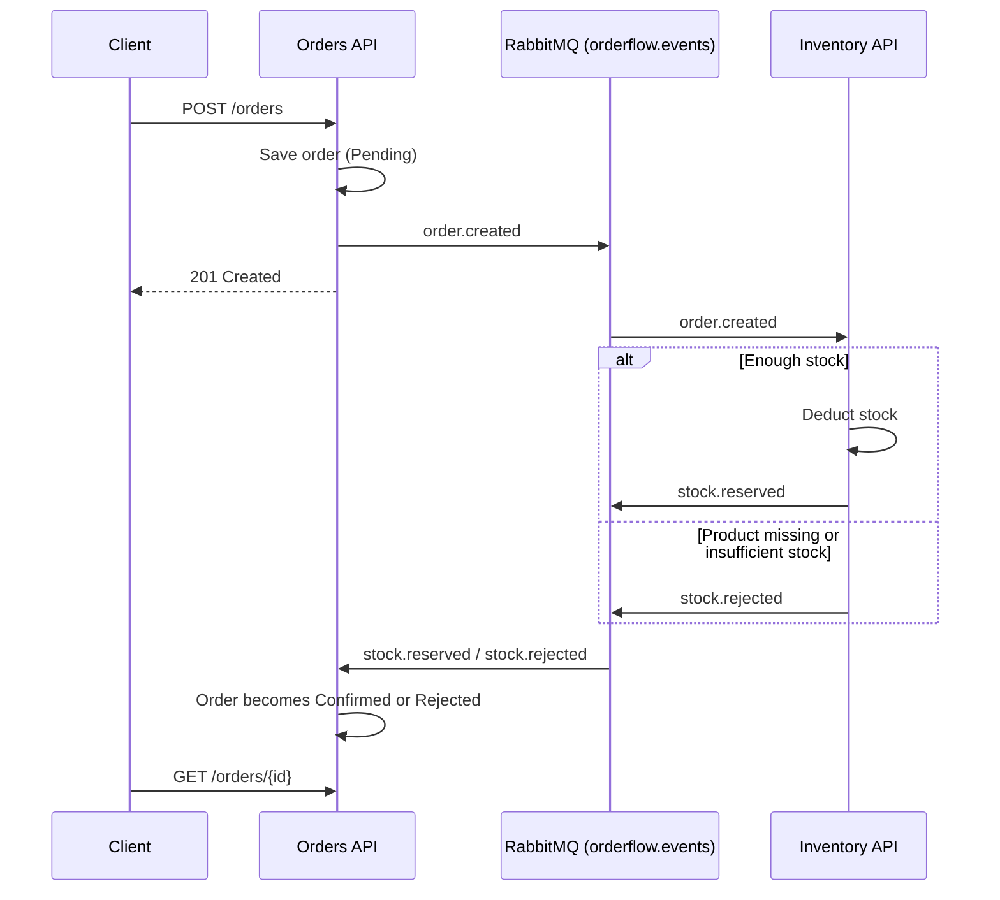

# OrderFlow

Event-driven microservices built with **.NET 9**, **RabbitMQ** and **SQL Server**.

Two independent services communicate only through events: **Orders** accepts and tracks orders, **Inventory** reserves stock. Neither service calls the other directly.

## How it works



| Event | Published by | Consumed by | Effect |
|---|---|---|---|
| `order.created` | Orders | Inventory | Tries to deduct stock |
| `stock.reserved` | Inventory | Orders | Order becomes `Confirmed` |
| `stock.rejected` | Inventory | Orders | Order becomes `Rejected` |

Design notes:

- A single durable **topic exchange** (`orderflow.events`) with one durable queue per consumer.
- Stock is deducted with a single conditional `UPDATE ... WHERE StockQuantity >= @quantity`, so concurrent orders cannot oversell.
- Orders only moves an order out of `Pending`, so a redelivered message cannot overwrite a final status.
- Event contracts live in a shared `OrderFlow.Contracts` project.

## Requirements

- [.NET 9 SDK](https://dotnet.microsoft.com/download/dotnet/9.0)
- [Docker](https://www.docker.com/) with Docker Compose

## Getting started

### 1. Configure the environment

```powershell
Copy-Item .env.example .env
```

Edit `.env` and replace the placeholder passwords.

### 2. Start the infrastructure

```powershell
docker compose up -d
```

This starts SQL Server (port `1434`) and RabbitMQ (ports `5672` and `15672` for the management UI).

### 3. Configure the services

Connection details are stored with [User Secrets](https://learn.microsoft.com/aspnet/core/security/app-secrets), so they never enter the repository. Use the same values you put in `.env`.

```powershell
# Orders
dotnet user-secrets set "RabbitMq:UserName" "orderflow" --project src/OrderFlow.Orders.Api
dotnet user-secrets set "RabbitMq:Password" "<RABBITMQ_PASSWORD>" --project src/OrderFlow.Orders.Api
dotnet user-secrets set "ConnectionStrings:OrdersDb" "Server=127.0.0.1,1434;Database=OrderFlowOrders;User Id=sa;Password=<MSSQL_SA_PASSWORD>;TrustServerCertificate=True" --project src/OrderFlow.Orders.Api

# Inventory
dotnet user-secrets set "RabbitMq:UserName" "orderflow" --project src/OrderFlow.Inventory.Api
dotnet user-secrets set "RabbitMq:Password" "<RABBITMQ_PASSWORD>" --project src/OrderFlow.Inventory.Api
dotnet user-secrets set "ConnectionStrings:InventoryDb" "Server=127.0.0.1,1434;Database=OrderFlowInventory;User Id=sa;Password=<MSSQL_SA_PASSWORD>;TrustServerCertificate=True" --project src/OrderFlow.Inventory.Api
```

### 4. Create the databases

Install the EF Core CLI once, then apply the migrations of each service (the User Secrets from the previous step must already be set):

```powershell
dotnet tool install --global dotnet-ef

dotnet ef database update --project src/OrderFlow.Orders.Api
dotnet ef database update --project src/OrderFlow.Inventory.Api
```

### 5. Run the services

Each service needs its own terminal:

```powershell
dotnet run --project src/OrderFlow.Inventory.Api   # http://localhost:5212
dotnet run --project src/OrderFlow.Orders.Api      # http://localhost:5232
```

## Try it

```powershell
# Create a product with 50 units in stock
$product = Invoke-RestMethod -Method Post -Uri http://localhost:5212/products -ContentType "application/json" -Body '{"name":"Keyboard","stockQuantity":50}'

# Enough stock: the order ends up Confirmed
$ok = Invoke-RestMethod -Method Post -Uri http://localhost:5232/orders -ContentType "application/json" -Body (@{ productId = $product.id; quantity = 1 } | ConvertTo-Json)

# Insufficient stock: the order ends up Rejected
$rejected = Invoke-RestMethod -Method Post -Uri http://localhost:5232/orders -ContentType "application/json" -Body (@{ productId = $product.id; quantity = 100 } | ConvertTo-Json)

# Both orders start as Pending; give the events a moment to be processed
Start-Sleep -Seconds 1
Invoke-RestMethod -Uri "http://localhost:5232/orders/$($ok.id)"
Invoke-RestMethod -Uri "http://localhost:5232/orders/$($rejected.id)"

# The stock went from 50 to 49
Invoke-RestMethod -Uri "http://localhost:5212/products/$($product.id)"
```

The RabbitMQ management UI is available at http://localhost:15672 with the credentials from your `.env`.

## Project structure

```
src/
  OrderFlow.Contracts/      Shared event contracts
  OrderFlow.Orders.Api/     Orders service (publisher + stock result consumer)
  OrderFlow.Inventory.Api/  Inventory service (order consumer + stock event publisher)
docker-compose.yml          SQL Server and RabbitMQ
```

## Known limitations and next steps

- **No transactional outbox.** If the stock deduction succeeds but publishing the response fails, the stock stays deducted without an event. An outbox table would make this atomic.
- **No dead-letter queue.** Messages that cannot be processed are discarded with a `Nack`.
- **No automated tests yet.**